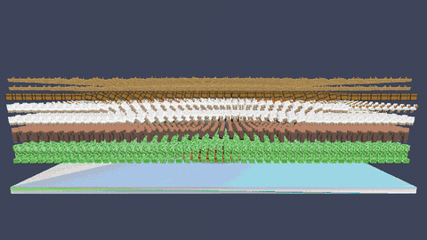

# Quacknado

A C++20 tornado sandbox for Apple Silicon. Move a tornado through 10,000 objects with Jolt physics, SDL3, and Metal rendering.

## Demo



## Running

### Prerequisites

- macOS on Apple Silicon
- Xcode with the Metal compiler
- CMake 4.4+, Ninja, and Python 3.10+

### Build and run

From the repository root:

```sh
git submodule update --init --recursive
cmake --preset default
cmake --build --preset default -j 8
./build/default/quacknado
```

Use the **arrow keys** to move the tornado. Close the window to exit.
