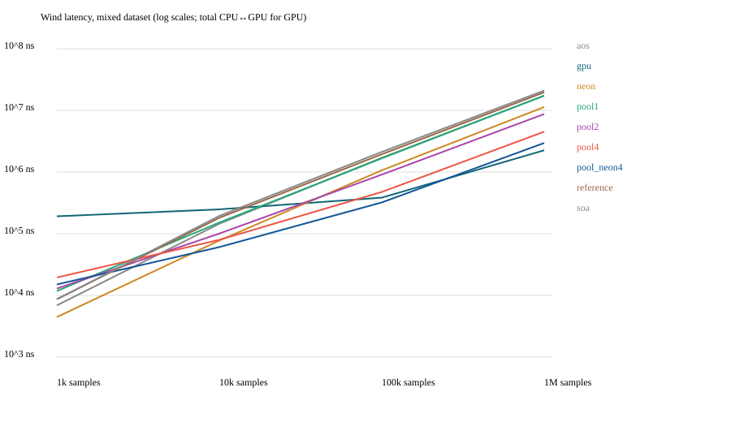
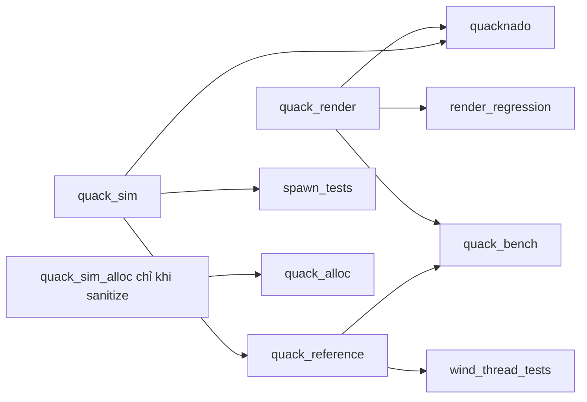

# Quacknado: đo và tối ưu CPU, SIMD, concurrency và Metal GPU

## Kết luận hiện tại cho reviewer

Project có ba nhóm bằng chứng: (1) thay đổi đã tích hợp vào game và đo end-to-end, (2) kernel/algorithm experiments giữ reference, (3) correctness/memory/provenance gates. Không gộp speedup của ba nhóm thành một con số.

| Quyết định | Bằng chứng | Phạm vi kết luận |
|---|---|---|
| Dùng GLB instancing | Windowed submission 0,266 → 0,084 ms; pixel regression qua | Headroom CPU/GPU, chưa chứng minh FPS tăng |
| Dùng pose-only sync và single-lock BodyState | Exact trajectory test; sync ~2,85×, access-path tổng update ~1,04× | Scene/seed/trajectory ghi trong campaign |
| Giữ direct wind mặc định | Pool tích hợp không thắng end-to-end | Tránh thêm thread làm chậm scene nhỏ |
| Giữ NEON/GPU như backend experiment | Calibrated CPU kernels, GPU round-trip/crossover | Sample kernel, không phải 1M rigid bodies |
| Không claim toàn simulation zero-allocation | C++ new không phát sinh trong fixture, Jolt vẫn allocate | Allocation domain được đo, không phải mọi malloc |
| Dùng null-safe intrusive ownership | Unit refcount tests; GPU ASan/UBSan fail-fast + Metal Validation | Không suppress finding; giữ log lỗi lịch sử |

Điểm bắt đầu để kiểm chứng: CTest CPU; `scripts/check_reference.py`; GPU `render_regression`; windowed `scripts/benchmark_windowed.py`. Các campaign chứa raw CSV và metadata; vòng sau khắc phục giới hạn vòng trước, nên đọc kết luận này trước nhật ký. Python integration hiện qua CLI/CSV và independent reference, chưa có native binding hay agentic LLM trong runtime.


Ngày đo: 29/10/2026. Đây là báo cáo thí nghiệm chạy thật trên Apple M1 Pro, macOS 14.7.5, Apple Clang 16, C++20, Release. Compiler flags và source SHA-256 nằm trong `results/metadata.json`; commit trong metadata là base commit, các thay đổi được đo nằm trong working tree. Không bật fast-math cho kernel hay Metal compute.

## Mục tiêu và phạm vi

Biến demo tornado thành một bộ thí nghiệm có reference, correctness checks, raw data và lệnh tái lập. Chứng minh khả năng phân tích layout, thuật toán, SIMD, synchronization và CPU/GPU overhead qua số liệu. Jolt tiếp tục quản lý rigid bodies; sample wind độc lập không tương đương một rigid body.

Đã tích hợp vào simulation thật: `ForceAt()` tránh lặp phép tính hình học và trả sớm khi ngoài vùng ảnh hưởng; reserve container scene; số object cấu hình được, giới hạn 1000 theo capacity Jolt; optional phase profiling và lựa chọn evaluator phục vụ A/B. Các backend SoA/NEON/pool/GPU và grid hiện là thí nghiệm độc lập. Rendering instancing là fixture offscreen, chưa thay renderer GLB trong game.

## Phương pháp và correctness

Seed 42, cùng input cho mọi backend. Ba distribution: mixed (gồm ngoài độ cao), inside, outside; mỗi dataset chèn trục tâm, biên độ cao/radius và trường hợp dưới đáy. Sweep 1k/10k/100k/1M sample. Mỗi backend wind warmup 3 lượt rồi đo 20 lượt; thứ tự các cấu hình được shuffle cố định. Trong mỗi lượt, đồng hồ đo một batch; checksum đọc output sau vùng đo để giữ công việc sống. Không dùng timer cho từng sample.

CPU tính trên buffer đã chuẩn bị; SoA conversion nằm ngoài timing. GPU wall time bao gồm memcpy input → encode → commit → wait → memcpy output. `gpu_ns` là khoảng thời gian command buffer GPU, không gồm CPU wait/copy. Buffer và pipeline khởi tạo một lần. Điều này phản ánh caller AoS cần kết quả trên CPU; không đại diện pipeline GPU-resident.

Reference C++ giữ nguyên công thức cũ trong `benchmarks/tornado_reference.cpp`. Mọi backend wind phải thỏa `abs(actual-reference) <= 2e-4 + 2e-5*abs(reference)` cho từng component, output hữu hạn. NEON xử lý bốn sample, phần dư dùng scalar. `exp` trong NEON vẫn gọi scalar libm từng lane; không dùng approximation. GPU và NEON hiện chuyên biệt cho bộ tham số tornado mặc định; NEON nhận center hiện tại, shader fixture dùng center mặc định.

Python prototype dùng double precision độc lập, gọi binary lấy 10.003 fixture rồi đối chiếu cùng tolerance. Sai số tuyệt đối lớn nhất 0,0002054 vẫn thỏa tolerance kết hợp. Phép toán float/fused operations không đòi bitwise equality.

10/10 CTest qua ở Release và Debug ASan/UBSan. UBSan vptr bị tắt vì Jolt build không cung cấp RTTI tương ứng; Jolt vendored không được instrument bởi tùy chọn sanitizer của project. Worker pool được chạy riêng với ThreadSanitizer, bao gồm tạo/hủy và nhiều thế hệ job với 0/1/3/10003 sample. Log kiểm tra lưu cạnh báo cáo. Correctness check spatial so mọi query với linear AABB; rendering so toàn bộ pixel RGBA8 giữa individual và instanced.

## Kết quả

Các bảng dưới lấy median từ `results/summary.csv`. p95/p99 của microbenchmark chỉ là phân vị giữa 20 batch, không phải tail latency mỗi sample hay bằng chứng thống kê đủ mạnh. Biểu đồ dùng log scale.



### Wind mixed: 1 triệu sample

| Backend | N | Median (ms) | p95 (ms) | GPU (ms) |
|---|---:|---:|---:|---:|
| aos | 1000000 | 17.2393 | 17.4857 | 0.0000 |
| gpu | 1000000 | 2.2554 | 2.4683 | 0.5942 |
| neon | 1000000 | 11.3421 | 11.4455 | 0.0000 |
| pool1 | 1000000 | 17.4045 | 17.4838 | 0.0000 |
| pool2 | 1000000 | 8.7241 | 8.7680 | 0.0000 |
| pool4 | 1000000 | 4.5173 | 4.5446 | 0.0000 |
| pool_neon4 | 1000000 | 2.9606 | 2.9843 | 0.0000 |
| reference | 1000000 | 19.6587 | 20.4236 | 0.0000 |
| soa | 1000000 | 20.9780 | 21.9247 | 0.0000 |

### Wind mixed: 1.000 sample

| Backend | N | Median (ms) | p95 (ms) | GPU (ms) |
|---|---:|---:|---:|---:|
| aos | 1000 | 0.0069 | 0.0127 | 0.0000 |
| gpu | 1000 | 0.1917 | 0.2353 | 0.0167 |
| neon | 1000 | 0.0045 | 0.0045 | 0.0000 |
| pool1 | 1000 | 0.0118 | 0.0192 | 0.0000 |
| pool2 | 1000 | 0.0129 | 0.0169 | 0.0000 |
| pool4 | 1000 | 0.0195 | 0.0347 | 0.0000 |
| pool_neon4 | 1000 | 0.0151 | 0.0239 | 0.0000 |
| reference | 1000 | 0.0087 | 0.0137 | 0.0000 |
| soa | 1000 | 0.0086 | 0.0156 | 0.0000 |

### Rendering offscreen: 10.000 triangle

| Backend | N | Median (ms) | p95 (ms) | GPU (ms) |
|---|---:|---:|---:|---:|
| render_individual | 10000 | 1.5701 | 1.6992 | 0.6565 |
| render_instanced | 10000 | 0.3118 | 0.3256 | 0.0917 |
| submit_individual | 10000 | 0.6424 | 0.6529 | 0.0000 |
| submit_instanced | 10000 | 0.0090 | 0.0134 | 0.0000 |

### Spatial: 1.000 boxes uniform, 1.000 queries/batch

| Backend | N | Median (ms) | p95 (ms) | GPU (ms) |
|---|---:|---:|---:|---:|
| grid_4 | 1000 | 0.0123 | 0.0312 | 0.0000 |
| grid_build_4 | 1000 | 0.1080 | 0.1080 | 0.0000 |
| jolt_4 | 1000 | 5.8886 | 5.9541 | 0.0000 |
| linear_4 | 1000 | 0.4594 | 0.4621 | 0.0000 |

### Simulation: 600 object yêu cầu

| Backend | N | Median (ms) | p95 (ms) | GPU (ms) |
|---|---:|---:|---:|---:|
| simulation | 600 | 0.7242 | 1.2324 | 0.0000 |
| simulation_physics | 600 | 0.5540 | 1.0168 | 0.0000 |
| simulation_reference | 600 | 0.7321 | 1.1689 | 0.0000 |
| simulation_reference_physics | 600 | 0.5690 | 0.9580 | 0.0000 |
| simulation_reference_spawn | 600 | 0.0021 | 0.0041 | 0.0000 |
| simulation_reference_sync | 600 | 0.0320 | 0.0340 | 0.0000 |
| simulation_reference_wind | 600 | 0.1365 | 0.1794 | 0.0000 |
| simulation_spawn | 600 | 0.0021 | 0.0040 | 0.0000 |
| simulation_sync | 600 | 0.0320 | 0.0349 | 0.0000 |
| simulation_wind | 600 | 0.1259 | 0.1812 | 0.0000 |


## Giải thích kết quả và quyết định

**CPU và memory.** `ForceAt()` cũ tính radius, distance, height rồi gọi `VelocityAt()` tính lại. Bản mới reuse các đại lượng đó; out-of-range trả sớm, giữ reference để kiểm tra. AoS sample chứa hai `simd_float3` nên 32 byte/sample do alignment; SoA input 24 byte/sample, output 16 byte/sample. AoS input+output khoảng 48 MB ở 1M; SoA khoảng 40 MB, chưa tính reference và bản AoS giữ cho correctness. Dung lượng nhỏ hơn không đảm bảo nhanh hơn: scalar SoA phải gather nhiều stream rồi tái tạo vector. Giữ AoS cho game hiện tại.

**SIMD.** NEON vectorize arithmetic qua bốn sample, giữ scalar `exp` và chọn đoạn lift. Compiler report của scalar loop cho thấy loop không vectorize; assembly có `fsqrt.4s`, `fdiv.4s`, `fmul.4s`, `fmla.4s` (file evidence). Đây là vectorization giữa sample, khác với chỉ dùng float3 cho một object. Giữ scalar fallback cho phần dư. Không thay công thức vật lý để lấy speedup.

**Concurrency.** Persistent pool dùng condition variable và generation counter. Main publish job/count dưới mutex, worker ghi range output riêng, pending counter và barrier đảm bảo main chỉ đọc khi xong. Không allocate thread mỗi update, không đồng thời gọi Jolt từ worker. Template harness nhận callable, tránh virtual dispatch ở vòng đo. Pool 1 worker lượng hóa chi phí dispatch/wait. Kết hợp NEON và bốn worker là CPU variant nhanh nhất trong mixed 1M; workload nhỏ chịu overhead và scheduling. Partition tĩnh, chưa có work stealing hay chunk-size sweep; máy Apple Silicon có P/E cores nên scaling không đồng nhất.

**GPU.** Với batch lớn, compute Metal thắng CPU nhanh nhất đã triển khai ở một số cấu hình; với batch nhỏ, submission và synchronization chi phối. Crossover chỉ được xác định giữa những điểm sweep đã đo, không phải một ngưỡng chính xác. Không diễn giải GPU execution time đơn lẻ như latency người gọi. Không offload scene vài trăm rigid body trong game chỉ dựa trên kết quả 1M sample.

**Spatial.** Fixture 100/600/1000 static boxes, 1000 query/batch, uniform hoặc clustered. So linear scan, grid 2D cell size 1/4/16 (kiểm tra AABB 3D cuối cùng), Jolt broadphase. Grid insert box vào mọi cell giao nhau để không bỏ sót object lớn/biên âm. Linear worst case O(N) mỗi query; grid O(C+K) với C cell truy cập, K candidate (có thể lặp), worst case vẫn O(N) với query cố định. Build O(N+M), M là tổng membership; memory O(M+cells). Grid chậm đi nếu density/box size khiến nhiều membership hoặc phải rebuild liên tục. Build timing hiện chỉ một sample, chưa đủ kết luận ổn định. Jolt fixture dùng body creation trực tiếp, chưa gọi OptimizeBroadPhase; lock/filter và cách xây tree ảnh hưởng mạnh, vì vậy không suy rộng thành so sánh tổng quát với Jolt. Chưa thay broadphase của game.

**Rendering.** Fixture vẽ triangle trên texture 256×256, cùng vertex/fragment work và placement, so N draw với một draw N instances, readback pixel sau vùng đo. Đây là bằng chứng submission batching và Metal API; không phải benchmark GLB nhiều mesh/material/texture, không phải FPS toàn game. Chưa tối ưu renderer thật bằng kết quả của fixture này.

**Toàn simulation.** Chạy 60 warmup step rồi đo từng step trong 600 step tại dt=1/60, tornado đi theo +X. Scene cùng seed và số object, A/B reference/optimized riêng process. Dataset raw ghi `placed_N` theo step (gồm prop tĩnh), không có active/sleeping count. Sau khoảng 10 giây tornado có thể rời vùng scene; workload thay đổi theo thời gian có chủ đích nên p99 ở đây là cả trajectory. Physics chi phối tổng latency; giảm wind không đồng nghĩa toàn simulation tăng cùng tỷ lệ. Clock instrumentation có overhead, bật giống nhau cho cả A/B. Sự khác biệt tổng thời gian nhỏ không được xem là improvement chắc chắn, nhất là floating-point divergence có thể làm contact evolution khác nhau.

## Tái lập

Từ repo root trên Apple Silicon với Xcode/Metal toolchain:

```sh
cmake -S . -B build/perf -G Ninja -DCMAKE_BUILD_TYPE=Release
cmake --build build/perf -j 8
ctest --test-dir build/perf --output-on-failure
python3 scripts/check_reference.py
python3 scripts/run_benchmarks.py
python3 scripts/analyze_results.py
```

Metal và sysctl cần chạy trong môi trường có quyền truy cập GPU/hardware info. `--cpu-only` bỏ compute/render GPU. Python chỉ dùng standard library. Raw CSV, metadata, summary và SVG được ghi vào `docs/benchmarks/results/`; hãy dùng `--output` khác để giữ nhiều campaign độc lập.

```sh
cmake -S . -B build/check -G Ninja -DCMAKE_BUILD_TYPE=Debug -DQUACK_SANITIZE=ON
cmake --build build/check --target quack_bench spawn_tests wind_thread_tests -j 8
ctest --test-dir build/check --output-on-failure
clang++ -std=c++20 -O1 -g -fsanitize=thread -I src -I benchmarks tests/wind_thread_tests.cpp src/simulation/env/tornado.cpp benchmarks/tornado_reference.cpp -o /tmp/quack-tsan
/tmp/quack-tsan
```

Ví dụ chạy riêng, positional arguments là `N repetitions dataset backend`:

```sh
build/perf/Release/quack_bench 10003 20 mixed pool_neon4
build/perf/Release/quack_bench 1000000 20 mixed gpu
build/perf/Release/quack_bench 1000 20 uniform spatial
build/perf/Release/quack_bench 600 600 mixed simulation
build/perf/Release/quack_bench 10000 20 offscreen render
```

## Giới hạn và hướng tiếp theo

Đây là một campaign trên một máy, không pin affinity/clock, không cô lập thermal state. Các repetition liên tiếp dùng cùng dataset/cache; chưa có confidence interval giữa nhiều campaign/process. Re-run riêng trong môi trường ít tải trước khi dùng số cụ thể trên CV. Không có hardware-counter/cache-miss đo trực tiếp, không có allocation counter nên chưa tuyên bố zero-allocation toàn simulation. Spatial memory mới phân tích complexity, chưa đo RSS/index bytes. Chưa có Python native binding hay agentic AI; Python integration hiện là subprocess/CSV và independent reference.

Ưu tiên tiếp theo từ bằng chứng: profile Jolt ở trajectory thực tế; đo active/sleeping bodies và contact count; đưa GLB instancing vào renderer theo mesh/material rồi đo frame p99; thử batch snapshot/force application trước khi đưa worker/GPU vào simulation. Chỉ chọn backend khi giảm end-to-end cost ở workload thật.

Portfolio này thể hiện C++20/RAII/STL/template harness, layout/alignment, complexity và spatial indexing, SIMD assembly, worker synchronization và Python orchestration. Khi phỏng vấn, trình bày cả experiment thắng và thua, đặc biệt scalar SoA và GPU workload nhỏ; mọi claim nên dẫn tới raw data và lệnh tái lập.

## Vòng cải tiến 2: broadphase và SIMD culling (29/10/2026)

Giữ nguyên campaign đầu trong `results/`. Vòng mới ở `refinement/`: năm campaign, mỗi cấu hình chạy process riêng, warmup 3 lượt rồi 30 batch; báo median của năm campaign-median và khoảng min–max giữa campaign. Wind shuffle thứ tự job; spatial giữ thứ tự before → optimize → after. Lượt thu chính thức chạy sau khi build/sanitizer đã xong. Đây vẫn là một máy và chưa kiểm soát thermal/affinity.

**Jolt:** thêm `PhysicsWorld::OptimizeBroadPhase()` để thử rebuild sau bulk insertion tại điểm không có Step/query đồng thời. Mỗi cell-size fixture tạo PhysicsWorld mới; tránh tree đã optimize làm nhiễm baseline sau. Cả before/after đều kiểm tra từng query với linear reference. Chi phí optimize được đo riêng một lần mỗi process/fixture, tổng năm sample. Đây là phép thử cấu hình thư viện, không phải thuật toán broadphase tự viết. Không tự động gọi mỗi frame hoặc thay grid vào game.

**NEON:** thêm backend `neon_cull`, giữ `neon` làm control. Sau khi tính bán kính, dùng mask kiểm tra cả bốn lane ngoài vùng ảnh hưởng; nếu đúng thì ghi zero và bỏ các phép tính tiếp theo. Nhóm có lane còn hoạt động đi qua implementation cũ. Kiểm tra numerical tolerance như vòng đầu, test 10.003 sample cho phần dư. Chưa chọn culling làm mặc định vì overhead mask có thể bất lợi ở dataset inside.

| Backend | Dataset | N | Median (ms) | Khoảng campaign (ms) |
|---|---|---:|---:|---:|
| jolt_after_4 | clustered | 1000 | 0.0278 | 0.0278–0.0278 |
| jolt_after_4 | uniform | 1000 | 0.1064 | 0.1055–0.1070 |
| jolt_before_4 | clustered | 1000 | 6.0143 | 6.0128–6.0313 |
| jolt_before_4 | uniform | 1000 | 5.8957 | 5.8881–5.9226 |
| jolt_optimize_4 | clustered | 1000 | 0.0998 | 0.0942–0.1068 |
| jolt_optimize_4 | uniform | 1000 | 0.1006 | 0.0818–0.1275 |
| neon | inside | 1000000 | 11.9713 | 11.9330–12.0512 |
| neon | mixed | 1000000 | 11.1041 | 11.0061–11.2267 |
| neon | outside | 1000000 | 2.5324 | 2.5246–2.5373 |
| neon_cull | inside | 1000000 | 12.1244 | 12.1230–12.2482 |
| neon_cull | mixed | 1000000 | 10.5836 | 10.5668–10.6294 |
| neon_cull | outside | 1000000 | 0.4958 | 0.4945–0.5162 |

Các tỷ lệ dưới dùng median của campaign-median; spatial timing là batch 1.000 query:

- NEON culling, mixed: 1.05× so với NEON cũ.
- NEON culling, inside: 0.99× so với NEON cũ.
- NEON culling, outside: 5.11× so với NEON cũ.
- Jolt uniform, 1.000 body: query 55.42×; rebuild 0.1006 ms; hòa vốn ước lượng 17.4 query nếu workload không đổi.
- Jolt clustered, 1.000 body: query 216.41×; rebuild 0.0998 ms; hòa vốn ước lượng 16.7 query nếu workload không đổi.

Giới hạn quan trọng: query clustered vẫn lấy đều trong vùng rộng, nên có nhiều query trống; chưa đại diện query tập trung trong cụm. Before/after spatial không hoán đổi thứ tự vì mutation tree, do đó vẫn có order/cache bias dù đã warmup. Không ngoại suy speedup spatial sang FPS hoặc pipeline spawn đang thay đổi liên tục.

Kiểm tra: 11/11 CTest Release và ASan/UBSan qua; shader/GPU không thay đổi ở vòng này. Mỗi batch spatial và mỗi backend wind đều kiểm tra correctness. Raw data và summary được lưu riêng; tái lập bằng `python3 scripts/refine_benchmarks.py` rồi `python3 scripts/summarize_refinement.py` sau khi build Release.

## Vòng 3: tối ưu sync trên simulation thật

`Simulation::Update()` trước đây đọc full body state chỉ để lấy position/orientation khi sync sau physics: gồm cả velocity và center of mass không dùng. Thêm `ReadPose()` chỉ đọc position/rotation; giữ switch `pose_only_sync` để A/B. Pose-only là mặc định trong game. Không bỏ qua static body vì orientation của prop vẫn cần đồng bộ sau khởi tạo.

Năm campaign process riêng, 100/300/600 object, 60 warmup và 600 step đo; đảo thứ tự baseline/optimized theo seed. Raw log ghi placed và active rigid bodies từng step. Mọi cặp phải khớp chính xác chuỗi checksum vị trí và occupancy; checksum không chứng minh mọi component bằng nhau nên test trực tiếp cũng đối chiếu position/quaternion ReadPose với ReadState.

| Backend | N | Median campaign-median (ms) | Min–max (ms) |
|---|---:|---:|---:|
| simulation | 100 | 0.0521 | 0.0511–0.0531 |
| simulation | 300 | 0.2445 | 0.2429–0.2510 |
| simulation | 600 | 0.7041 | 0.7007–0.7134 |
| simulation_fullstate | 100 | 0.0556 | 0.0549–0.0580 |
| simulation_fullstate | 300 | 0.2562 | 0.2548–0.2602 |
| simulation_fullstate | 600 | 0.7263 | 0.7217–0.7344 |
| simulation_fullstate_sync | 100 | 0.0055 | 0.0055–0.0057 |
| simulation_fullstate_sync | 300 | 0.0162 | 0.0161–0.0162 |
| simulation_fullstate_sync | 600 | 0.0321 | 0.0320–0.0321 |
| simulation_sync | 100 | 0.0019 | 0.0019–0.0019 |
| simulation_sync | 300 | 0.0057 | 0.0057–0.0059 |
| simulation_sync | 600 | 0.0112 | 0.0112–0.0114 |

Tỷ lệ cải thiện phase sync và tổng update là hai số khác nhau:

- 100 object: sync 2.91×; tổng update 1.067×.
- 300 object: sync 2.83×; tổng update 1.048×.
- 600 object: sync 2.85×; tổng update 1.031×.

Tái lập: `python3 scripts/benchmark_sync.py`. Kết quả ở `sync/`. Tổng update có thể nằm trong nhiễu do physics chi phối; không suy rộng speedup của sync thành FPS. Active-body telemetry và checksum nằm ngoài vùng đo tổng update. Đây là tối ưu API/read-path và giảm công việc thừa trong game, khác với kernel fixture độc lập.

Verification vòng 3: 11/11 ASan/UBSan tests qua cho pose-only sync; thêm kiểm tra CLI từ chối backend không tồn tại, Release 12/12 tests qua. Trước đây tên backend sai có thể kết thúc thành công mà không đo gì; nay báo lỗi để runner không lưu một benchmark rỗng như thành công. Metadata ở `sync/` là snapshot lúc đo trước thay đổi validation CLI; numerical path không thay đổi. Build toàn game, shader và copy assets thành công. Các hạng mục chưa hoàn tất được theo dõi trong `next-iterations.md`; goal cải tiến vẫn đang active.

## Vòng 4: worker pool trong wind pipeline thật

Đưa worker pool vào `src/core`, hỗ trợ truyền exception về caller và tái sử dụng pool sau lỗi. Simulation có backend tùy chọn 1/2/4 worker: main đọc BodyState → worker tính bốn điểm lực → main apply theo nguyên thứ tự → Jolt Step. Worker không gọi Jolt. Buffer reserve theo số object khi chọn backend; không tạo thread mỗi frame. Chế độ trực tiếp vẫn là mặc định cho đến khi end-to-end chứng minh lợi ích.

Correctness mạnh hơn checksum: test chạy tuần tự bốn Simulation cùng seed (tránh Jolt global factory đồng thời), 120 step với tornado đổi hướng; so chính xác position, COM, quaternion, linear/angular velocity từng body/step cho 0/1/2/4 worker. Test pool còn kiểm tra exception propagation và reuse sau lỗi.

Năm campaign độc lập, 60 warmup + 600 measured steps, thứ tự backend shuffle. So cả wind phase và tổng update; snapshot, dispatch, wait và apply nằm trong vùng đo. Raw giữ occupancy và checksum, mọi backend phải khớp direct.

| Backend | Requested objects | Median campaign-median (ms) | Min–max (ms) |
|---|---:|---:|---:|
| simulation | 100 | 0.0518 | 0.0510–0.0553 |
| simulation | 600 | 0.7088 | 0.6998–0.7263 |
| simulation | 1000 | 1.5359 | 1.5213–1.5634 |
| simulation_pool1 | 100 | 0.0597 | 0.0586–0.0860 |
| simulation_pool1 | 600 | 0.7159 | 0.7128–0.7201 |
| simulation_pool1 | 1000 | 1.5485 | 1.5392–1.5684 |
| simulation_pool1_wind | 100 | 0.0248 | 0.0245–0.0323 |
| simulation_pool1_wind | 600 | 0.1348 | 0.1329–0.1367 |
| simulation_pool1_wind | 1000 | 0.2304 | 0.2261–0.2347 |
| simulation_pool2 | 100 | 0.0607 | 0.0596–0.0860 |
| simulation_pool2 | 600 | 0.7216 | 0.7175–0.7410 |
| simulation_pool2 | 1000 | 1.5528 | 1.5507–1.5775 |
| simulation_pool2_wind | 100 | 0.0264 | 0.0255–0.0346 |
| simulation_pool2_wind | 600 | 0.1392 | 0.1356–0.1469 |
| simulation_pool2_wind | 1000 | 0.2174 | 0.2158–0.2176 |
| simulation_pool4 | 100 | 0.0884 | 0.0877–0.0939 |
| simulation_pool4 | 600 | 0.7443 | 0.7438–0.7565 |
| simulation_pool4 | 1000 | 1.5546 | 1.5416–1.7144 |
| simulation_pool4_wind | 100 | 0.0396 | 0.0384–0.0426 |
| simulation_pool4_wind | 600 | 0.1341 | 0.1338–0.1364 |
| simulation_pool4_wind | 1000 | 0.2100 | 0.2072–0.2455 |
| simulation_wind | 100 | 0.0211 | 0.0211–0.0219 |
| simulation_wind | 600 | 0.1260 | 0.1256–0.1435 |
| simulation_wind | 1000 | 0.2185 | 0.2146–0.2199 |

End-to-end speedup so với direct:

- N=100: 1 worker: 0.867×, 2 worker: 0.853×, 4 worker: 0.586×.
- N=600: 1 worker: 0.990×, 2 worker: 0.982×, 4 worker: 0.952×.
- N=1000: 1 worker: 0.992×, 2 worker: 0.989×, 4 worker: 0.988×.

Không cộng speedup microkernel vào physics: các lock/read/apply và Jolt step vẫn tuần tự. 1.000 requested object không đảm bảo 1.000 body active; raw ghi placed/active. Worker pool không hỗ trợ nested run hoặc nhiều caller đồng thời; ownership thuộc Simulation/main thread. Exact equality đã kiểm tra cho fixture nêu trên, không phải chứng minh mọi scene/CPU. Đây là experiment tích hợp thật, giữ direct mặc định nếu các variant không thắng ổn định. Tái lập: `python3 scripts/benchmark_pipeline.py` sau khi build Release.

Quyết định vòng 4: giữ direct làm mặc định. Pool 4 worker có end-to-end ratio 0,952× ở 600 object và 0,988× ở 1.000 object; vì vậy không tuyên bố cải thiện game từ microbenchmark đa luồng. ASan/UBSan 12/12 tests qua, gồm trajectory test mới; TSan standalone pool qua cả exception/reuse, chưa instrument toàn Jolt.

## Vòng 5: giảm lock trên đường truy cập Jolt

ReadState gộp ba lần lấy state thành một BodyLockRead, tạo snapshot đồng bộ. ApplyForceAt bỏ GetMotionType riêng vì Jolt AddForce đã kiểm tra IsDynamic dưới write lock và thực hiện activation đúng semantics. Ba backend là old (3 reads + motion check), read_only (1 read + motion check), optimized (1 read + không check thừa). Không dùng NoLock hay gọi Jolt từ worker.

Test trajectory so chính xác position, COM, rotation và linear/angular velocity với old path trong 120 step đổi hướng; static prop không nhận force vẫn được kiểm tra. Năm campaign độc lập, thứ tự backend shuffle, 60 warmup + 600 step, N=100/600/1000. Từng cặp khớp checksum vị trí và placed/active occupancy.

| Backend | N | Median (ms) | Khoảng campaign (ms) |
|---|---:|---:|---:|
| simulation | 100 | 0.0468 | 0.0460–0.0485 |
| simulation | 600 | 0.6724 | 0.6592–0.6795 |
| simulation | 1000 | 1.4807 | 1.4691–1.5163 |
| simulation_access_old | 100 | 0.0524 | 0.0512–0.0529 |
| simulation_access_old | 600 | 0.7013 | 0.6986–0.7153 |
| simulation_access_old | 1000 | 1.5335 | 1.5312–1.5372 |
| simulation_access_old_wind | 100 | 0.0212 | 0.0211–0.0217 |
| simulation_access_old_wind | 600 | 0.1276 | 0.1251–0.1283 |
| simulation_access_old_wind | 1000 | 0.2165 | 0.2148–0.2186 |
| simulation_read_only | 100 | 0.0482 | 0.0481–0.0491 |
| simulation_read_only | 600 | 0.6815 | 0.6780–0.6858 |
| simulation_read_only | 1000 | 1.4976 | 1.4924–1.5088 |
| simulation_read_only_wind | 100 | 0.0177 | 0.0177–0.0186 |
| simulation_read_only_wind | 600 | 0.1054 | 0.1050–0.1084 |
| simulation_read_only_wind | 1000 | 0.1844 | 0.1835–0.1888 |
| simulation_wind | 100 | 0.0142 | 0.0141–0.0146 |
| simulation_wind | 600 | 0.0877 | 0.0858–0.0892 |
| simulation_wind | 1000 | 0.1485 | 0.1479–0.1496 |

- N=100: tổng update 1.120×, wind phase 1.495×.

- N=600: tổng update 1.043×, wind phase 1.455×.

- N=1000: tổng update 1.036×, wind phase 1.458×.

Giữ raw/metadata riêng trong access/. Đo toàn Update có physics, lock, sync, respawn; không ngoại suy thành FPS. ReadState mới fail-fast với invalid BodyID, các caller simulation lọc invalid trước khi đọc. Tái lập: python3 scripts/benchmark_access.py.

Verification vòng 5: Release và ASan/UBSan 12/12 tests qua; toàn game/shader build thành công. `access/source-snapshot.tar.gz` lưu source đã kiểm tra khớp từng SHA-256 trong manifest tại thời điểm đo, kèm CMake và `compile-commands.json`. Archive không chứa external dependencies/assets; cần checkout cùng dependencies của project để build. Checksum của archive nằm trong `source-snapshot.sha256`. Script cập nhật section cũng đã được sửa để chạy lại vòng cũ không xóa các vòng sau, kiểm tra preservation và idempotence đã qua.

## Vòng 6: GLB instancing tích hợp renderer game

Application nhóm ModelDraw theo model path. Mỗi primitive của asset giữ vertex/index buffer, texture và material cũ; shader dùng instance_id để đọc orientation/translation/scale riêng. Chia batch tối đa 80 transform × 48 byte = 3.840 byte. setVertexBytes sao chép dữ liệu vào storage của command; không có shared instance buffer bị CPU ghi đè khi GPU còn đọc. Giữ cờ instancing=false để đối chiếu cùng renderer. Hiện pipeline hỗ trợ opaque/alpha-mask, không dùng chiến lược nhóm này cho alpha-blended material cần sort.

Benchmark gọi ModelDraw::Initialize/Record và shader thật, dùng chicken/creeper/chest GLB, rotation và vị trí khác nhau, depth test/write và texture. Render offscreen 256×256, kiểm tra ảnh không rỗng và pixel RGBA8 bằng nhau hoàn toàn giữa individual và instanced. 81 object kiểm tra batch tail; 600 object kiểm tra nhiều batch. Năm process/cấu hình, warmup 3, đo 30 frame. Submission và GPU-wait end-to-end được đo riêng; image readback/check nằm ngoài timing.

| Metric/backend | Model | N | Median campaign-median | Khoảng campaign |
|---|---|---:|---:|---:|
| glb_draws_individual | chest | 81 | 81.000 calls | 81.000–81.000 |
| glb_draws_individual | chest | 600 | 600.000 calls | 600.000–600.000 |
| glb_draws_individual | chicken | 81 | 648.000 calls | 648.000–648.000 |
| glb_draws_individual | chicken | 600 | 4800.000 calls | 4800.000–4800.000 |
| glb_draws_individual | creeper | 81 | 81.000 calls | 81.000–81.000 |
| glb_draws_individual | creeper | 600 | 600.000 calls | 600.000–600.000 |
| glb_draws_instanced | chest | 81 | 2.000 calls | 2.000–2.000 |
| glb_draws_instanced | chest | 600 | 8.000 calls | 8.000–8.000 |
| glb_draws_instanced | chicken | 81 | 16.000 calls | 16.000–16.000 |
| glb_draws_instanced | chicken | 600 | 64.000 calls | 64.000–64.000 |
| glb_draws_instanced | creeper | 81 | 2.000 calls | 2.000–2.000 |
| glb_draws_instanced | creeper | 600 | 8.000 calls | 8.000–8.000 |
| glb_render_individual | chest | 81 | 0.296 ms | 0.288–0.305 |
| glb_render_individual | chest | 600 | 0.552 ms | 0.524–0.555 |
| glb_render_individual | chicken | 81 | 0.516 ms | 0.483–0.537 |
| glb_render_individual | chicken | 600 | 1.824 ms | 1.694–1.829 |
| glb_render_individual | creeper | 81 | 0.352 ms | 0.333–0.356 |
| glb_render_individual | creeper | 600 | 0.672 ms | 0.636–0.675 |
| glb_render_instanced | chest | 81 | 0.253 ms | 0.238–0.269 |
| glb_render_instanced | chest | 600 | 0.370 ms | 0.361–0.377 |
| glb_render_instanced | chicken | 81 | 0.331 ms | 0.313–0.339 |
| glb_render_instanced | chicken | 600 | 0.570 ms | 0.554–0.580 |
| glb_render_instanced | creeper | 81 | 0.322 ms | 0.308–0.325 |
| glb_render_instanced | creeper | 600 | 0.487 ms | 0.472–0.499 |
| glb_submit_individual | chest | 81 | 0.022 ms | 0.020–0.023 |
| glb_submit_individual | chest | 600 | 0.090 ms | 0.084–0.093 |
| glb_submit_individual | chicken | 81 | 0.100 ms | 0.090–0.107 |
| glb_submit_individual | chicken | 600 | 0.710 ms | 0.636–0.712 |
| glb_submit_individual | creeper | 81 | 0.021 ms | 0.020–0.024 |
| glb_submit_individual | creeper | 600 | 0.097 ms | 0.096–0.101 |
| glb_submit_instanced | chest | 81 | 0.009 ms | 0.009–0.010 |
| glb_submit_instanced | chest | 600 | 0.012 ms | 0.011–0.013 |
| glb_submit_instanced | chicken | 81 | 0.012 ms | 0.011–0.013 |
| glb_submit_instanced | chicken | 600 | 0.023 ms | 0.022–0.025 |
| glb_submit_instanced | creeper | 81 | 0.010 ms | 0.009–0.011 |
| glb_submit_instanced | creeper | 600 | 0.013 ms | 0.013–0.014 |

Ở 600 object:

- chicken: CPU submission 31.05×.

- creeper: CPU submission 7.50×.

- chest: CPU submission 7.37×.

Đây là renderer GLB production được tích hợp vào Application, nhưng phép đo vẫn offscreen chứ chưa phải FPS cửa sổ game. Modes luôn individual trước instanced, do đó còn order/cache bias. Không có scene mixed-model image regression hay camera chuyển động trong fixture hiện tại. Các model không được instantiate ở cùng chỗ để tránh depth-tie tạo khác biệt do đổi primitive order. Benchmark serial wait mỗi frame; lifetime correctness nhiều frame dựa trên copy semantics của setVertexBytes, chưa có stress test nhiều frame-in-flight. Tái lập: build toàn Release để tạo object.metallib, rồi `python3 scripts/benchmark_glb.py` trong môi trường có GPU access.

Verification vòng 6: Release và ASan/UBSan 12/12 tests qua (CPU/physics suite; không tự nhận là sanitizer phủ GPU). Metal API Validation bật và chạy 161 chicken, ảnh khớp, không báo lỗi API; log ở `glb/metal-validation.log`. Source archive được kiểm tra khớp manifest, metadata bổ sung SHA-256 của ba GLB asset và metallib. Với 600 chicken (8 primitives), draw calls giảm 4.800 → 64; shader/material/texture giữ cùng kết quả fixture.

## Vòng 7: allocation instrumentation, không suy đoán zero-allocation

Thêm executable quack_alloc riêng, không liên kết counter vào timing benchmark hoặc game. Global throwing C++ new/new[] và aligned new được đếm bằng atomic; delete tương ứng dùng free. Hook Jolt Allocate/AlignedAllocate/Reallocate riêng, restore hook trước khi hủy Simulation. Vùng đếm chỉ gồm Update sau 60 warmup; output/telemetry/constructor/hủy scene nằm ngoài. Counters bao phủ worker threads. Self-test kiểm tra số call và requested byte chính xác qua scalar/array/aligned C++ cùng ba đường Jolt. CTest bổ sung gate không có C++ allocation trên trajectory direct/pool 100 object.

| Requested objects | Workers | C++ new calls | Jolt alloc/realloc calls | Jolt requested bytes | Max Jolt calls/step |
|---|---:|---:|---:|---:|---:|
| 100 | 0 | 0 | 1200 | 1133072 | 2 |
| 100 | 1 | 0 | 1200 | 1133072 | 2 |
| 100 | 4 | 0 | 1200 | 1133072 | 2 |
| 600 | 0 | 0 | 1200 | 6649664 | 2 |
| 600 | 1 | 0 | 1200 | 6649664 | 2 |
| 600 | 4 | 0 | 1200 | 6649664 | 2 |
| 1000 | 0 | 0 | 1201 | 11555104 | 3 |
| 1000 | 1 | 0 | 1201 | 11555104 | 3 |
| 1000 | 4 | 0 | 1201 | 11555104 | 3 |

Stack trace chẩn đoán riêng cho thấy hai call lặp trong Jolt QuadTree::UpdatePrepare và QuadTree::BuildTree, không phải std::vector hoặc tạo worker mỗi frame. Lưu ở allocations/jolt-trace.log. Không sửa vendored Jolt hay tắt broadphase update để đạt con số đẹp. Chưa tuyên bố zero-allocation toàn simulation; điều chứng minh được là không có allocation qua các đường C++ new được intercept trong trajectory đã đo, trong khi Jolt vẫn cấp phát.

Requested bytes là tổng kích thước yêu cầu cấp phát, gồm kích thước mới của realloc; không phải live memory, peak RSS hay memory bandwidth. Không intercept malloc/calloc trực tiếp của SDL/libc/Metal hoặc allocation hệ điều hành, không có stack sampling cho mọi allocation. Hai miền counter có thể chồng lấp nếu allocator implementation tương lai gọi C++ new; không cộng chúng thành số allocation toàn process. Jolt hook dùng global allocator, chỉ cài tại điểm không có physics job đang chạy; fixture dùng Jolt single-thread. Diagnostic backtrace chạy riêng và không dùng số đếm của lượt diagnostic để kết luận. `QUACK_ALLOC_TRACE=1` bật hai stack trace đầu.

Tái lập: build target quack_alloc, chạy `python3 scripts/benchmark_allocations.py`. Dữ liệu này không được dùng so latency vì atomic/counter overhead thay đổi timing. Giữ game/benchmark timing không có instrumentation.

Verification vòng 7: 15/15 tests qua ở Release và cấu hình Debug kiểm tra. Trong cấu hình Debug, các target physics/kernel trước đó có ASan/UBSan; riêng quack_alloc dùng allocator replacements nên chạy không instrument sanitizer, ba test allocation không được tính là sanitizer coverage. Trace chẩn đoán được lưu riêng, snapshot source đã đối chiếu SHA-256 và có archive. Chín cấu hình memory đều ghi nhận C++ new calls bằng 0; Jolt 1.200 calls/600 step ở N=100/600 và 1.201 ở N=1000, call bổ sung ở scene lớn chưa được quy nguyên nhân bằng trace riêng.

## Vòng 8: mixed-model regression và transform lifetime

Thêm executable `render_regression` gọi đúng ModelDraw và shader production. Reference giữ một draw module cho từng object theo thứ tự scene; optimized nhóm theo chicken/creeper/chest như Application. Test dùng depth test/write, texture, rotation và translation khác nhau qua ba frame. So toàn bộ RGBA8 bằng nhau, không dùng image tolerance.

Ma trận gồm 0/1/237/240/243/600 object, mỗi mức có chế độ lọc awaiting_spawn và invalid BodyID. 237/240/243 tương ứng 79/80/81 instance mỗi model khi không lọc, kiểm tra ngay trước/đúng/sau giới hạn batch 80. Scene >1 object phải có pixel khác màu clear và frame 0 phải khác frame 2. Scene rỗng và scene một object bị lọc phải ra đúng ảnh clear; không yêu cầu nonempty sai cho trường hợp đó.

Reference encode → wait → readback từng frame. Optimized encode ba command buffer, mỗi frame dùng color/depth target riêng, không wait giữa các submit. Sau submit, CPU đổi mọi vị trí sang {999,999,999}; sau đó wait và so từng ảnh với reference đã lưu. Điều này kiểm tra việc command giữ bản copy instance bytes, thứ tự group, phần dư batch và bỏ qua object ẩn. GPU có thể hoàn tất frame sớm trước khi CPU submit hết; test chứng minh API usage theo cách submit không wait, không chứng minh ba frame thực sự thực thi đồng thời hay mọi lịch scheduling có thể có.

| Objects | Filtering | Frame comparisons | Individual draws / 3 frames | Instanced draws / 3 frames |
|---:|---|---:|---:|---:|
| 0 | off/on | 3 mỗi case | 0 | 0 |
| 1 | off | 3 | 24 | 24 |
| 1 | on | 3 | 0 | 0 |
| 237 | off | 3 | 2.370 | 30 |
| 237 | on | 3 | 1.959 | 30 |
| 240 | off | 3 | 2.400 | 30 |
| 240 | on | 3 | 1.989 | 30 |
| 243 | off | 3 | 2.430 | 60 |
| 243 | on | 3 | 2.016 | 30 |
| 600 | off | 3 | 6.000 | 90 |
| 600 | on | 3 | 5.016 | 90 |

12 case, 36 frame comparisons qua ở Release với Metal API Validation. Log và metadata ở `render-regression/`, có source snapshot và hashes của ba assets. Đây là correctness suite, không dùng runtime của suite làm benchmark latency/FPS. Trường hợp group thay đổi thứ tự draw vẫn có thể khác khi model chồng bề mặt đồng phẳng/depth-tie, hoặc alpha blend cần sort; fixture không chứng minh mọi scene. Camera vẫn là camera cố định production; chưa có camera sweep hoặc screenshot cửa sổ game.

Tái lập từ repo root sau khi build:

```sh
cmake --build build/perf --target render_regression -j 8
MTL_DEBUG_LAYER=1 ./build/perf/Release/render_regression build/perf/Release/object.metallib
```

Có thể đăng ký vào CTest bằng `-DQUACK_GPU_TESTS=ON`, rồi chạy `ctest --test-dir build/perf -R mixed_glb_in_flight --output-on-failure` trong môi trường truy cập GPU được. Tùy chọn mặc định OFF để CPU-only sandbox không báo failure giả; executable manual không skip GPU thiếu, sẽ báo lỗi. Debug render_regression được instrument ASan/UBSan khi QUACK_SANITIZE=ON; đây là coverage CPU của renderer/loader, không phải sanitizer trên shader.

**Sanitizer finding vòng 8:** instrumented GPU executable hoàn tất và 12 dòng kết quả khớp Release, nhưng log có UBSan runtime errors ở đường NS::SharedPtr/NS::Referencing::release trong metal-cpp với receiver null. Metal dùng Objective-C messaging nil nhưng C++ wrapper vẫn bị UBSan báo null member call. Vì vậy lượt GPU ASan/UBSan này **không được coi là sạch**, dù process exit 0. Giữ nguyên `sanitized-validation.log`, chưa thêm suppression hoặc sửa vendored dependency. Cần làm rõ/fix ownership adapter để đạt sanitizer gate; đây là finding mới của GPU coverage, không bị che bởi CPU CTest xanh. `verification.txt` phân biệt pixel-pass với sanitizer finding. Goal chưa hoàn tất.

## Vòng 9: null-safe intrusive ownership, GPU sanitizer fail-fast

Thay NS::SharedPtr trong source/benchmark/test của project bằng quacknado::metal::Ptr. Adapter chỉ gọi retain/release khi pointer khác null; adopt giữ +1 từ new/alloc, retain dùng cho borrowed autoreleased object. Copy tăng reference, move chuyển quyền và xóa source, assignment dùng copy/move-and-swap để xử lý alias/self-assignment. Không sửa vendored metal-cpp và không thêm sanitizer suppression. Không dùng std::shared_ptr control block hoặc allocation mới cho mỗi resource handle.

Test với mock intrusive object kiểm tra null, copy, move, self-copy/self-move, alias assignment, reset và destruction count. GPU regression vẫn so 12 case/36 frame với baseline vòng 8. Lượt GPU chạy ASan/UBSan với halt_on_error=1 cùng Metal API Validation, log không có runtime error/ASan report; pixel/draw counts khớp baseline. Coverage vẫn là ba asset và fixture đã mô tả, không phải chứng minh mọi Metal API.

Đo lại GLB 600 object, 5 process/model, 30 frame sau 3 warmup; không diễn giải đây là speedup riêng của ownership adapter. Individual và instanced đều dùng adapter mới.

| Model | Submission individual (ms) | Submission instanced (ms) | Ratio |
|---|---:|---:|---:|
| chicken | 0.7133 | 0.0227 | 31.38× |
| creeper | 0.0996 | 0.0140 | 7.11× |
| chest | 0.0922 | 0.0129 | 7.17× |

Release và Debug configuration 16/16 CTest qua; GPU fail-fast chạy riêng vì sandbox GPU access. Vẫn có ngoại lệ đã công bố: quack_alloc dùng replacements riêng, không instrument sanitizer. Log và raw ở ownership/. Finding vòng 8 được giữ nguyên như lịch sử, khắc phục ở vòng này.

Tái lập GPU check: `UBSAN_OPTIONS=halt_on_error=1:print_stacktrace=1 ASAN_OPTIONS=halt_on_error=1 MTL_DEBUG_LAYER=1 ./build/check/Debug/render_regression build/check/Debug/object.metallib`. Sau khi lưu output vào ownership/gpu-results.csv và stderr vào ownership/gpu-validation.log, chạy `python3 scripts/benchmark_ownership.py` để xác minh baseline và đo lại submission. Không tái dùng kết quả nếu renderer fixture đã đổi mà baseline không còn phù hợp.

## Vòng 10: calibrated batches và uncertainty của kernel benchmark

Thêm --calibrated cho một CPU kernel backend. Sau correctness/warmup, số invocation trong một batch tăng gấp đôi đến khi lượt calibration đạt ít nhất 5 ms (giới hạn 2^20, không đạt thì fail). Mỗi invocation có compiler memory barrier để tránh hoist/eliminate công việc lặp trên cùng input/output. Sau đó đo 12 batch với số invocation cố định và báo wall_ns/invocation; checksum nằm ngoài timer. Không đổi behavior default để giữ cách tái lập campaign cũ.

Mỗi cấu hình chạy năm process, thứ tự cấu hình shuffle theo campaign. Sweep inside/outside/mixed tại 1k và 1M sample. Lưu actual iterations và calibration duration riêng, không suy ra từ rounded timing. Các batch sau calibration có thể ngắn hơn 5ms nếu clock/cache thay đổi; target dùng chọn số lặp, không đảm bảo minimum mỗi repetition. Dataset được lặp lại hot-cache, không đại diện streaming workload mới mỗi invocation. Pool timing vẫn gồm dispatch/wait.

Speedup dùng geometric mean của năm tỷ lệ reference/variant theo campaign, mỗi tỷ lệ lấy process median. Khoảng 95% dùng percentile bootstrap resample năm campaign-ratio, 10.000 lần, seed 42. Với chỉ năm campaign đây là khoảng mô tả thăm dò, không đảm bảo coverage chuẩn hoặc kết luận significance. CV là độ lệch chuẩn population/mean của năm process median. Không gọi p99 của batch average là p99 invocation.

| Backend | Dataset | N | Median ns/invocation | CV process medians | Speedup vs reference | Bootstrap 95% interval |
|---|---|---:|---:|---:|---:|---:|
| aos | mixed | 1000 | 6165 | 0.8% | 1.44× | 1.43–1.45× |
| aos | mixed | 1000000 | 17465562 | 0.9% | 1.15× | 1.14–1.16× |
| neon | mixed | 1000 | 4627 | 0.9% | 1.93× | 1.92–1.94× |
| neon | mixed | 1000000 | 11539334 | 1.2% | 1.73× | 1.70–1.76× |
| neon_cull | inside | 1000000 | 12467625 | 1.5% | 1.52× | 1.51–1.54× |
| neon_cull | mixed | 1000 | 4513 | 1.0% | 1.97× | 1.95–1.99× |
| neon_cull | mixed | 1000000 | 11071874 | 0.7% | 1.81× | 1.79–1.83× |
| neon_cull | outside | 1000000 | 537488 | 0.8% | 16.62× | 16.51–16.74× |
| pool4 | mixed | 1000 | 17474 | 4.3% | 0.52× | 0.51–0.55× |
| pool4 | mixed | 1000000 | 4547208 | 1.0% | 4.39× | 4.35–4.42× |
| pool_neon4 | mixed | 1000 | 16548 | 14.7% | 0.58× | 0.52–0.68× |
| pool_neon4 | mixed | 1000000 | 3011166 | 0.6% | 6.65× | 6.59–6.73× |
| reference | mixed | 1000 | 8871 | 0.3% | 1.00× | 1.00–1.00× |
| reference | mixed | 1000000 | 20007584 | 1.2% | 1.00× | 1.00–1.00× |

Kết quả mới không thay raw của vòng đầu. Không gộp kết quả calibrated với single-batch timing vì chính sách cache/measurement khác. Chưa pin affinity, khóa frequency hay đo thermal state; processor scheduling/P-E cores vẫn ảnh hưởng. Đây là cải thiện chất lượng phép đo, không phải claim kernel mới nhanh hơn do tăng batch. Correctness được chạy trước mỗi process measurement. CPU calibration không dùng cho simulation, render hoặc GPU; CLI từ chối thay vì báo thành công nhưng đo sai scope.

Tái lập: build quack_bench rồi `python3 scripts/benchmark_calibrated.py`. Log/metadata/raw/calibration records ở calibrated/.

Verification vòng 10: 180 process runs, 2.160 measurement rows và 36 cấu hình đủ số lượng; tất cả calibration records đạt target và source hashes khớp snapshot. Release và cấu hình Debug kiểm tra 18/18 tests qua; ngoại lệ instrumentation của allocation target giữ như vòng 7. Adapter/CPU/GPU regression logic không đổi trong vòng này. Reference/reference ratio 1 và interval 1 là do normalization cùng mẫu, không chứng minh baseline không có nhiễu (CV vẫn được báo). Compiler barrier mới thuộc helper timing; mặc định vẫn một invocation/batch nhưng timing lịch sử phải gắn source/version tương ứng, không đảm bảo helper mới tái tạo chính xác số cũ.

## Vòng 11: windowed replay trên game thật

Thêm QUACK_REPLAY_FRAMES (1..2000) và QUACK_REPLAY_MODE=individual/instanced. Chỉ khi replay được bật, scene dùng seed 42, 600 object, đúng một Update dt=1/60 mỗi frame, tornado đổi chiều X mỗi 60 step; input keyboard không điều khiển replay. Replay tự kết thúc, không ghi I/O trong vòng đo. Normal interactive loop vẫn dùng accumulator. Individual giữ thứ tự module/object gốc; instanced dùng grouping production.

Renderer giữ tối đa ba command đã submit trước khi retire command cũ, thu GPU timestamp sau completion, không completion callback truy cập dữ liệu đã hủy. CPU submission đo sau nextDrawable đến commit, không gồm chờ drawable; Render call gồm drawable wait và retire wait. CPU frame gồm poll events + simulation + Render; checksum/telemetry nằm ngoài vùng đó. FinishProfile drain các command còn lại trước khi xuất CSV; thời gian drain cuối run không thuộc từng frame. Đây là replay presentation-paced, không dùng tổng runtime làm FPS tương tác hay throughput không giới hạn.

Ba campaign/process mỗi mode, shuffle thứ tự, 210 frames/run, bỏ 30 đầu; raw giữ physical pixel size, active bodies và checksum. Mỗi cặp mode phải khớp trajectory/checksum/active/resolution. Chưa có screenshot regression toàn scene; kiểm tra ảnh vòng 8/9 vẫn là fixture riêng.

| Mode | Metric | Median của campaign median (ms) | Median của campaign p99 (ms) |
|---|---|---:|---:|
| individual | cpu_frame_ns | 8.332 | 9.073 |
| individual | gpu_command_ns | 1.600 | 1.773 |
| individual | render_call_ns | 7.072 | 8.078 |
| individual | simulation_ns | 1.203 | 3.432 |
| individual | submission_ns | 0.266 | 1.280 |
| instanced | cpu_frame_ns | 8.328 | 9.575 |
| instanced | gpu_command_ns | 1.405 | 1.589 |
| instanced | render_call_ns | 7.009 | 7.928 |
| instanced | simulation_ns | 1.294 | 3.837 |
| instanced | submission_ns | 0.084 | 0.270 |

P99 từ 180 frame/campaign chỉ là thống kê mô tả ngắn, chưa đủ mô tả rare tail. Window compositor, refresh rate, focus/visibility, power và GPU load không được khóa. NextDrawable/presentation có thể che bớt lợi ích submission; không suy speedup từ microbenchmark thành FPS. Profiling có overhead và bookkeeping; bộ đệm timing được reserve trước run nhưng đây không phải zero-allocation gate. Tái lập: build toàn game Release, chạy `python3 scripts/benchmark_windowed.py` trong desktop session có GPU/window access; cửa sổ mở và tự đóng cho từng process. Không tự bỏ qua lỗi drawable/command hoặc người dùng đóng cửa sổ giữa replay.

Verification vòng 11: 6 process × 210 frames = 1.260 rows, một physical resolution duy nhất, exact physics checksum/active/resolution match từng cặp mode. Campaign đầu bị resize giữa run nên gate từ chối; raw/log giữ trong `windowed/invalid-resize/`, không dùng tính bảng. Replay sau đó tắt SDL_WINDOW_RESIZABLE, chỉ riêng replay, campaign hợp lệ được chạy lại toàn bộ. Bộ CTest Release và Debug kiểm tra 19/19 qua. Application thực chạy thêm 30-frame Debug replay với ASan/UBSan halt-on-error + Metal Validation, không runtime error/ASan report trong log. Smoke Debug chỉ kiểm tra correctness/lifetime, không dùng làm số liệu performance.

Kết luận windowed: median submission khoảng 0,266 → 0,084 ms (3,15×), GPU command khoảng 1,60 → 1,40 ms, nhưng median CPU frame của hai mode đều khoảng 8,33 ms trong presentation-paced run. Không có bằng chứng FPS tăng 3× hoặc 31×. Time saved ở submission là headroom CPU; toàn frame còn chờ display/drawable. Profile drain cuối run chưa phân bổ vào per-frame times, nên không dùng CPU frame median để suy throughput tổng process.


## Vòng 12: regression gate có noise budget và invalid-data checks

`perf_gate.py` so hai calibrated campaign cùng environment identity (OS/arch/CPU/compiler/build-cache hash), workload keys và measurement policy. Mỗi workload cần >=5 process, đủ repetitions/IDs không trùng, timing hữu hạn dương, và calibration evidence đủ/đạt target. Campaign cũ thiếu identity không được tự coi tương thích. Gate bảo thủ: budget latency 5%, noise CV 10%, bootstrap percentile interval từ 10.000 independent process-median resamples. Ba trạng thái: PASS / REGRESSION / INCONCLUSIVE với exit 0/1/2. Lower interval vượt 1,05 báo regression; phần còn lại nếu CV cao hoặc upper vượt budget thì inconclusive. Đây là policy mô tả, chưa calibration familywise error khi nhiều workload, chưa đủ bằng chứng code là nguyên nhân.

Chạy hai campaign mới trên **cùng binary hash và cùng environment** (baseline/candidate), mỗi campaign 180 process. Kết quả control INCONCLUSIVE, không có verdict regression: vài workload nhỏ/noisy và neon_cull còn interval rộng. Không đổi policy chỉ để tạo bảng xanh. Fault injection nhân mọi baseline wall_ns lên 1,30 trả REGRESSION; folder synthetic-slowdown có NOT_A_REAL_RUN.txt, không dùng nó làm measured performance. Chín unit cases kiểm tra same-data, known slowdown, noise, incomplete/duplicate, NaN, environment mismatch, missing/subthreshold calibration.

Runner calibrated nay nhận `--output`, từ chối ghi đè thư mục đã có dữ liệu, `--no-report` dùng cho campaign regression để không viết lại vòng 10. Hardware/compiler identity được thu trước chạy. Phép so yêu cầu build-cache hash giống nhau có thể từ chối cả thay đổi cấu hình không ảnh hưởng timing; đó là hạn chế bảo thủ cần xác nhận lại, không nới tự động.

```sh
python3 scripts/benchmark_calibrated.py --output docs/benchmarks/my-new-baseline --no-report
python3 scripts/benchmark_calibrated.py --output docs/benchmarks/my-new-candidate --no-report
python3 scripts/perf_gate.py docs/benchmarks/my-new-baseline docs/benchmarks/my-new-candidate --output /tmp/perf-gate.json
python3 scripts/test_perf_gate.py
```

Bản ghi vòng này ở regression/. Candidate có source snapshot khớp manifest. Baseline được thu trước khi hoàn thiện gate/test scripts nên không tự dựng archive toàn source hiện tại rồi tuyên bố là baseline snapshot; binary/kernel runner giữ nguyên giữa hai lượt, hardware identity và binary hash đã đối chiếu. Không dùng source hashes của script phân tích mới để giả vờ là artifact có từ trước. Phần kết luận đầu báo cáo được bổ sung để reviewer phân biệt implementation production, experiment, negative result và giới hạn.

Verification vòng 12: Release và cấu hình Debug kiểm tra 20/20 CTest qua, trong đó perf_gate_policy chạy chín test Python. Gate control thật INCONCLUSIVE và injection REGRESSION được lưu trong JSON riêng. Không có optimization kernel mới trong vòng này; giá trị là phát hiện dữ liệu không hợp lệ, ngăn overwrite và buộc kết luận yếu được ghi đúng trạng thái. Source formatting/CMake/runner duplication còn cần cleanup để bộ bằng chứng dễ duy trì; goal chưa đánh dấu complete chỉ vì tests xanh.

## Vòng 13: dùng chung core targets và canonical source inventory

Root CMake hiện chỉ cấu hình dependency/options và include ba module: QuackTargets (target graph), QuackAssets (shader/assets), QuackTests (registration). Thay recursive source glob bằng danh sách production source rõ ràng. `quack_sim` dùng chung cho game, benchmark và tests; `quack_render` dùng chung cho game/GLB benchmark/GPU regression; reference implementation nằm trong target riêng. Release allocation probe dùng cùng simulation core. Chỉ trong sanitizer build mới có `quack_sim_alloc` plain, vì custom allocator probe không được link với instrumented simulation. Sanitizer runtime flags được propagate qua static libraries, compile instrumentation áp dụng rõ trên project targets; không instrument vendor.



Đếm từ compile_commands, **production source compile entries Release 31 → 12 cho 12 file**. Debug có 16 entry: 12 production file và bốn bản plain simulation cho allocation probe. Đây là giảm duplication/flag drift, chưa đo wall-time clean build nên không tuyên bố build nhanh hơn tỷ lệ 31/12. Các compile command trước/sau được lưu trong build-structure/. Audit flags đã loại generated/vendor PCH khỏi project scope; mọi source project trong Debug có instrumentation trừ allocation executable và plain core cố ý.

Source inventory được gom vào scripts/evidence.py. Tất cả campaign runner lấy danh sách canonical gồm src/shaders/benchmarks/tests/scripts/cmake và root CMakeLists/CMakePresets, bỏ build/vendor/__pycache__. Nhờ vậy snapshot mới không thiếu modular build definitions. Không tự sửa metadata lịch sử để giả vờ schema mới có từ lúc đo. Unit test kiểm tra build definitions được hash, build/vendor không lọt vào inventory và thay CMake module làm đổi hash. Assets/dependencies vẫn phải ghi identity riêng theo campaign.

Thêm preset perf/check, giữ default cũ. Tái lập cấu hình đúng bằng:

```sh
cmake --preset perf
cmake --build --preset perf -j 8
ctest --preset perf
cmake --preset check
cmake --build --preset check -j 8
UBSAN_OPTIONS=halt_on_error=1 ASAN_OPTIONS=halt_on_error=1 ctest --preset check
```

Release và Debug kiểm tra **21/21 CTest qua**, gồm policy suite và source inventory test. CPU calibrated NEON smoke vẫn chạy correctness trước đo. GPU mixed regression 12 case khớp baseline, chạy lại Debug ASan/UBSan halt-on-error + Metal Validation không runtime report. Có source snapshot bao gồm các file cmake mới. Không dùng số timing smoke ngắn để claim tốc độ mới; thay build graph không phải một algorithm optimization. Build-cache identity đổi sau refactor, do đó perf gate phải thu baseline/candidate tương thích mới thay vì cưỡng ép so với cache cũ.

## Vòng 14: audit cuối và cách trình bày portfolio

README được viết lại theo trạng thái thực tế: scene 600 requested objects, đúng build paths/presets, phân biệt measurement scope và đường dẫn báo cáo. Ghi chú README cũ giữ ở README-before-audit.md. C++ mới được format theo .clang-format. Campaign output helper dùng chung từ chối ghi đè metadata/raw/summary, hỗ trợ --output mới và giữ prepared GPU inputs; unit tests kiểm tra không thay dữ liệu cũ. Các runner giả định một writer/output directory, chưa có concurrent writer locking.

Audit phát hiện hai lỗi tái lập và một test bị bỏ quên: GLB shader hard-code build/perf (nay dùng SDL_GetBasePath cạnh executable), dataset typo bị coi là mixed (nay báo lỗi), test tornado cũ không đăng ký và kỳ vọng sai signs tại world point lệch tâm (nay kiểm tra theo điểm tương đối center, dùng runtime checks để Release cũng kiểm tra). Giữ log test-failure trước sửa trong review-audit/. Không đổi physics để làm test xanh. Thêm invariants top cutoff và translation invariance.

### Completion audit theo mục tiêu ban đầu

| Yêu cầu | Bằng chứng có thể kiểm tra | Kết luận |
|---|---|---|
| C++17+ / STL / ownership / templates | C++20 shared core targets, vector/span, intrusive RAII pointer, worker pool, generic timing harness; ownership tests | Có implementation và tests; không claim đã phủ toàn bộ ngôn ngữ |
| Data structures và complexity | Linear/grid/Jolt query experiments; distribution/cell-size/build-cost và worst-case discussion | Có thí nghiệm và trade-off; grid không bị ép vào game |
| Concurrency và low-level/SIMD | Persistent worker pool, exception/reuse tests, exact trajectories, TSan; NEON/compiler diagnostics/assembly và calibrated scaling | Có bằng chứng; direct vẫn mặc định do end-to-end pool chưa thắng |
| Python prototype / analysis / C++ integration | Independent math oracle 10.003 samples, CLI/CSV runners, bootstrap/noise gate và corruption tests | Có integration qua process/data; chưa có native binding |
| CPU/GPU và cải thiện project thật | Wind optimization, pose/state access, GLB instancing, windowed replay, GPU round-trip và pixel validation | Có measured production improvements và negative results |
| Tự benchmark, log và tài liệu đầy đủ | Raw/metadata/logs/snapshots theo vòng, report hiện tại, README chạy lại | Có đường truy nguyên, giữ giới hạn/version khác nhau |
| Agentic AI / networking / lock-free | Không triển khai | Các ví dụ tùy chọn của JD, không phải phần đã hoàn thành trong project |

### Verification trên trạng thái cuối

- Release: 24/24 CTest; Debug cấu hình kiểm tra: 24/24. Các ngoại lệ instrumentation đã công bố (vendor, allocation probe và UBSan vptr) vẫn áp dụng.
- Clean configure/build tại build/audit-clean không dùng object cũ: 24/24 CTest. GLB benchmark từ chính clean directory nạp shader cạnh binary và qua pixel comparison với Metal Validation.
- Independent Python oracle: 10.003 fixtures qua tolerance. TSan standalone pool phiên bản hiện tại exit 0, không report; không nhận là TSan toàn Jolt.
- Debug GPU mixed regression: 12 case / 36 frame comparisons, ASan/UBSan halt-on-error + Metal Validation, không runtime report; kết quả khớp baseline đã lưu.
- CPU calibrated smoke kiểm tra correctness và actual iteration record; không tạo speedup claim mới từ smoke.
- `git diff --check` sạch. Chưa commit/push/PR; các kết quả và source vẫn nằm trong working tree.

Log verification và snapshot ở review-audit/. Một lần build sạch trên máy hiện tại chưa chứng minh mọi máy/OS/compiler. Performance gate control còn INCONCLUSIVE ở vài workload; đó là kết luận measurement uncertainty được giữ nguyên, không phải blocker chức năng bị che. Không có bằng chứng FPS tăng theo tỷ lệ microbenchmark, zero-allocation toàn process, hay agentic LLM trong runtime.

**Đánh giá kết thúc:** mục tiêu nâng project thành portfolio C++ performance có chiều sâu và tự kiểm chứng đã đạt theo đánh giá kỹ thuật này. Những việc như network/LLM, native binding, full profiler/RSS, thêm platform hoặc kiểm định thống kê mạnh hơn là hướng mở rộng tùy chọn, không phải claim hiện tại. Câu chuyện phỏng vấn nên bám ba quyết định: tối ưu công việc thừa trước, đo cả pipeline trước khi bật concurrency/GPU, và giữ kết quả không thắng hoặc uncertainty trong báo cáo.

## Mục tiêu mới: tối ưu tương tác vật thể

Sau scope portfolio ban đầu, tiếp tục tối ưu phần physics/contact. Câu chuyện đầy đủ và dữ liệu nằm ở [interactions/story.md](interactions/story.md), gồm sáu vòng: profile collision/solver → thử Jolt workers → phát hiện crossover scene nhỏ → phản chứng long-run tail → thử QoS không chữa được p99 → giảm còn 1 worker và chọn policy.

Kết quả cuối ở scene 600 object, năm process/config × 900 frame: median physics **1,763 → 0,966 ms** (~45% giảm), median simulation **2,106 → 1,246 ms** (~41% giảm). Physics p99 **3,517 → 3,774 ms** (+7,3%), simulation p99 **4,144 → 4,316 ms** (+4,2%); CPU frame p99 gần như không đổi. Không suy thành FPS tăng. Game chọn 1 background physics worker khi có ít nhất 4 hardware threads; API simulation vẫn serial mặc định, `QUACK_PHYSICS_WORKERS=0` là fallback. QoS off mặc định. Không tắt va chạm, giảm solver iterations hoặc đổi collider để lấy tốc độ.

Release và Debug hiện **28/28 tests qua**; full-state worker/QoS tests, collision invariants và 4 × 60 frame Debug app smoke với ASan/UBSan + Metal Validation đã kiểm chứng. Hai campaign mới lưu **27.000 raw frames / 30 process logs**, metadata, measured-source snapshots và binary hashes. Audit/final source snapshot ở `interactions/final-verification/`; app smoke ở `interactions/final-smoke/`. Ngoại lệ sanitizer vendor/allocation/vptr vẫn áp dụng; không claim full-engine TSan. Quyết định giữ serial ở vòng IV là lịch sử trước thử nghiệm 1 worker, không phải default hiện tại.

Scope tối ưu tương tác đã có implementation production, đối chứng performance, correctness và tài liệu vòng lặp đầy đủ. Cải thiện ở median đi cùng trade-off tail đã công bố; không nhận là đã giải quyết mọi frame chậm. Bước profiling scheduler sâu hơn là hướng mở rộng nếu tiếp tục ưu tiên p99.


## Breakthrough tiếp theo: lag do đường build default và catch-up ở 1.000 vật thể

Phản ánh game vẫn lag đã dẫn tới [vòng VII đầy đủ](interactions/breakthrough/story.md). Benchmark worker trước chưa bao phủ build/default có build type rỗng (không optimization), scene interactive hiện tại 1.000 object và số physics step bù mỗi frame. Đã sửa preset default thành Release tại cùng đường chạy cũ, thêm fallback Release cho untyped configure, giữ explicit Debug. Không thay collision/solver/dt hoặc bỏ step bù.

Dense fixture giữ 1.000 body active: physics median **44,391 → 1,872 ms**, p99 **47,043 → 2,570 ms** (3 process/config). Real-clock game replay: frame p99 **137,469 → 20,655 ms**, số frame >33,33 ms **373/900 → 1/900**, sáu-step frames **310 → 0**. Median frame gần như không đổi vì presentation pacing; các tail/hitch metrics mới thể hiện đúng vấn đề người chơi gặp. Cross-build stored checksums khác, được giữ nguyên trong logs và không gọi là bitwise-correctness proof; mỗi build qua physical invariants, cùng build qua full-state worker tests mở rộng 100/600/1000 object. Default/perf/check hiện 33/33 CTest qua. Snapshot/metadata/raw/log/validation riêng ở interactions/breakthrough/; xem doc đó về fairness, giới hạn đo và cách chạy lại.


## Sửa population khi yêu cầu 10k

[Chi tiết và raw/log](spawn-10k/report.md). Scene lớn dùng shelf placement không overlap ngay khi khởi tạo, respawn hết trong cùng update; scene ≤1000 giữ random layout cũ. Kiểm tra seed42 từ step0 đến360: **10.003 actual body states / 0 pending ở mọi step**. Game thật 360 frame với Metal Validation: **10.002 model objects và 22.258 primitive instance invocations/frame**, floor vẽ riêng, 1.341 placement phục hồi/respawn mà không hụt population. Không gọi đây là visible-pixel count hoặc FPS benchmark. Metadata GLB nhiều primitive được đối chiếu với per-model census; dữ liệu verifier fail vì giả định single-primitive ban đầu cũng được giữ lại. Default app vẫn 1000; dùng QUACK_SCENE_COUNT=10000. Body slots dành 3 props nên max requested16381. Các trường hợp 10k/2seed/full capacity, overlap và mixed-GLB counter/pixels đều có validation riêng.


## Scene 10k không wind: worker policy theo quy mô contact pile

[Điều tra, raw/log và các thử nghiệm không thắng](collision-pile/story.md). App hiện mặc định 10.000 object nhưng vẫn giữ policy 1 worker của scene nhỏ. Đống tiếp xúc làm physics vượt 16,67 ms rồi gây vòng lặp catch-up. Chọn worker theo scene: 1 dưới 4.096, 2 dưới 8.192, 6 từ 8.192, giới hạn bởi hardware threads trừ 2; máy dưới 4 thread dùng serial. Override giữ nguyên. Solver, collider, sleep, dt và catch-up không đổi; QoS vẫn off.

Ba cặp đo trên M1 Pro: physics median **20,523 → 11,232 ms/step**; median của frame p99 theo process **185,620 → 14,543 ms**. Frame >33,33 ms **1.413 → 20/1.800**, six-step frame **1.386 → 1**. Có một lượt sau sửa vẫn có hitch lớn, được giữ trong báo cáo. Lượt dài mặc định 2.000 frame: p99 **16,476 ms**, 0 frame >33 ms, 0 six-step frame. Không suy CPU-frame timer thành FPS hay tuyên bố không còn stutter. Giữ đủ 10.003 body / 0 pending và 10.002 model objects mỗi frame. Full-state worker comparison và kiểm chứng cuối nằm trong bài riêng. Các con số default 600/1000 object ở phần cũ là lịch sử, không phải default app hiện tại.
